# ⚡ Dynamic Billing Engine

<p align="center">
  
  
  
  
  
</p>

<p align="center">
  <b>Advanced cost-intelligence & procurement OSINT engine for AI agents.</b><br/>
  <b>Menyelidiki biaya, bukan sekadar menghitungnya — setiap harga butuh bukti.</b>
</p>

---

## 🧠 What It Is / Apa Ini

Dynamic Billing Engine is an AI skill that turns cost estimation into **verifiable intelligence**. Instead of guessing a price, it researches the market, verifies evidence, classifies confidence, and produces auditable documents — RABs, BOQs, invoices, quotations, and supplier intelligence — in Indonesian or English.

Dynamic Billing Engine adalah skill AI yang mengubah estimasi biaya menjadi **intelijen yang dapat diverifikasi**. Alih-alih menebak harga, engine ini meneliti pasar, memverifikasi bukti, mengklasifikasi tingkat keyakinan, dan menghasilkan dokumen yang bisa diaudit — RAB, BOQ, invoice, quotation, dan intelijen supplier — dalam Bahasa Indonesia atau English.

> **NEVER CONFUSE AN ESTIMATE WITH A VERIFIED PRICE.**<br/>
> **JANGAN PERNAH MENYAMAKAN ESTIMASI DENGAN HARGA TERVERIFIKASI.**

It is not a calculator. It is a system combining a **Senior Cost Engineer · Quantity Surveyor · Procurement OSINT Specialist · Financial Controller · Commercial Analyst · Market Research Investigator · Supplier Verification Analyst · Strategic Purchasing Advisor**.

Bukan sekadar kalkulator. Ini sistem yang memadukan **Ahli Teknik Biaya · Quantity Surveyor · Spesialis Procurement OSINT · Financial Controller · Analis Komersial · Investigator Riset Pasar · Analis Verifikasi Supplier · penasihat Purchasing Strategis**.

---

## ✨ Feature Grid / Fitur Utama

| 🧮 Cost Engine | 📊 Market Price Intelligence |
|---|---|
| Deterministic formula library: line items, direct/indirect cost, contingency, tax, markup vs margin. Every calculation traceable per line item. | Live market research with source, URL, date accessed, MOQ, shipping and tax status recorded per price point. |
| **Mesin Biaya** — pustaka rumus deterministik: item baris, biaya langsung/tidak langsung, kontijensi, pajak, markup vs margin. Setiap hitungan bisa dilacak per item. | **Intelijen Harga Pasar** — riset harga pasar langsung dengan sumber, URL, tanggal akses, MOQ, status ongkir & pajak tercatat per harga. |

| 🔍 Procurement OSINT | 📄 RAB / BOQ Generation |
|---|---|
| Supplier discovery across the public web, evidence-backed trust grading (A–E), recommendation by total value — not just cheapest price. | Full quantity-surveying workflow: measure, decompose, compute quantities, apply Indonesian standards (SNI, AHSP, HSPK) when relevant. |
| **Procurement OSINT** — penemuan supplier di web publik, penilaian kepercayaan berbasis bukti (A–E), rekomendasi berdasarkan nilai total — bukan hanya harga termurah. | **Generasi RAB / BOQ** — alur quantity surveying lengkap: ukur, dekomposisi, hitung kuantitas, terapkan standar Indonesia (SNI, AHSP, HSPK) bila relevan. |

| 🧾 Invoice & Quotation Engine | 🎛️ Scenarios & What-If | 🔐 Audit Gate |
|---|---|---|
| 9 invoice types, quotation methodology with markup/margin separation, proforma & PO support. Never fabricates bank accounts, tax IDs, or company data. | Optimization passes produce alternatives, savings options, and A/B/C scenarios. Conflicting prices resolved as ranges with median and divergence explained. | Mandatory recalculation of every line, subtotal, tax, and grand total before presentation. Confidence assigned: HIGH / MODERATE / LOW / INSUFFICIENT — never faked percentages. |
| **Mesin Invoice & Quotation** — 9 tipe invoice, metodologi quotation dengan pemisahan markup/margin, dukungan proforma & PO. Tidak pernah mengarang rekening, NPWP, atau data perusahaan. | **Skenario & What-If** — optimasi menghasilkan alternatif, opsi penghematan, dan skenario A/B/C. Harga yang bertentangan diselesaikan sebagai rentang dengan median dan penjelasan divergensi. | **Audit Gate** — wajib menghitung ulang setiap baris, subtotal, pajak, dan total sebelum presentasi. Keyakinan diberi label: HIGH / MODERATE / LOW / INSUFFICIENT — tanpa persentase palsu. |

---

## 🔄 The 9-Step Intelligence Workflow / Alur Kerja 9 Langkah

```mermaid
flowchart LR
    S1["① UNDERSTAND<br/>Parse request,<br/>detect industry,<br/>extract scope"] --> S2["② DECOMPOSE<br/>Materials · Labor ·<br/>Equipment · Other"]
    S2 --> S3["③ RESEARCH<br/>Market prices +<br/>supplier discovery"]
    S3 --> S4["④ VERIFY<br/>Classify every price:"]
    S4 --> V{"VERIFIED?<br/>PARTIAL?<br/>INDICATIVE?<br/>ESTIMATED?<br/>UNAVAILABLE?"}
    V --> S5["⑤ CALCULATE<br/>Formulas, source<br/>per line item"]
    S5 --> S6["⑥ OPTIMIZE<br/>Alternatives,<br/>scenarios, savings"]
    S6 --> S7["⑦ GENERATE<br/>Invoice / RAB /<br/>Quotation / BOQ / Report"]
    S7 --> S8["⑧ AUDIT<br/>Recalculate all,<br/>fix before presenting"]
    S8 --> S9["⑨ PRESENT<br/>Premium 11-section<br/>audit report"]

    style S1 fill:#1f2937,stroke:#60a5fa,color:#fff
    style S2 fill:#1f2937,stroke:#60a5fa,color:#fff
    style S3 fill:#1f2937,stroke:#60a5fa,color:#fff
    style S4 fill:#1f2937,stroke:#f59e0b,color:#fff
    style S5 fill:#1f2937,stroke:#60a5fa,color:#fff
    style S6 fill:#1f2937,stroke:#60a5fa,color:#fff
    style S7 fill:#1f2937,stroke:#34d399,color:#fff
    style S8 fill:#1f2937,stroke:#f87171,color:#fff
    style S9 fill:#1f2937,stroke:#a78bfa,color:#fff
    style V fill:#111827,stroke:#f59e0b,color:#fbbf24
```



| Step / Langkah | English | Bahasa Indonesia |
|---|---|---|
| ① | Parse the request, detect industry, extract scope | Memahami permintaan, mendeteksi industri, mengekstrak lingkup |
| ② | Break scope into materials, labor, equipment, other direct cost | Memecah lingkup menjadi material, tenaga kerja, peralatan, biaya langsung lainnya |
| ③ | Research live market prices and suppliers when web access exists | Riset harga pasar dan supplier saat akses web tersedia |
| ④ | Classify every price on the verification ladder | Mengklasifikasikan setiap harga pada tangga verifikasi |
| ⑤ | Run formulas, keep source per line item | Menjalankan rumus, menyimpan sumber per item |
| ⑥ | Find alternatives, scenarios, savings | Mencari alternatif, skenario, dan penghematan |
| ⑦ | Generate invoice / RAB / quotation / BOQ / report | Menghasilkan invoice / RAB / quotation / BOQ / laporan |
| ⑧ | Recalculate everything; fix before presenting | Menghitung ulang semuanya; perbaiki sebelum presentasi |
| ⑨ | Deliver the premium 11-section report | Menyajikan laporan premium 11 bagian |

---

## 🪜 Price Verification Ladder / Tangga Verifikasi Harga

The core guarantee of the engine: **every price carries an honesty label.**

Jaminan inti engine ini: **setiap harga membawa label kejujuran.**

| Class / Kelas | Meaning / Arti | May present as / Boleh disajikan sebagai |
|---|---|---|
| ✅ **VERIFIED** | Live listed price on a traceable seller / Harga live di seller yang bisa dilacak | Real offer / Penawaran nyata |
| 🟡 **PARTIALLY VERIFIED** | Price seen, availability unconfirmed / Harga terlihat, ketersediaan belum pasti | "listed at…" / "tercantum di…" |
| 🔵 **INDICATIVE** | Published reference or historical data / Referensi publik atau data historis | Reference range / Rentang referensi |
| 🟠 **ESTIMATED** | Calculated with disclosed assumptions / Dihitung dengan asumsi yang diungkapkan | Estimate / Estimasi |
| ⛔ **UNAVAILABLE** | No reliable evidence found / Tidak ada bukti andal | Say so + give ESTIMATED fallback / Katakan apa adanya + berikan fallback ESTIMATED |

**Rules:** never upgrade a class upward. Every price records source, URL, date accessed, MOQ, shipping-included?, tax-included?, seller location.

**Aturan:** kelas tidak pernah dinaikkan. Setiap harga mencatat sumber, URL, tanggal akses, MOQ, termasuk ongkir?, termasuk pajak?, lokasi seller.

---

## 🏗️ Supported Industries / Industri yang Didukung

| Industry / Industri | Cost model emphasis / Fokus model biaya |
|---|---|
| 🏗️ **Construction** | BOQ, SNI/AHSP/HSPK references, wastage %, productivity, equipment & labor / BOQ, referensi SNI/AHSP/HSPK, % waste, produktivitas, peralatan & tenaga kerja |
| 🎪 **Events** | Venue, stage/sound/light/LED, crew, catering, logistics, documentation / Venue, panggung/suara/cahaya/LED, kru, katering, logistik, dokumentasi |
| 💻 **IT & Tech** | Hardware, licenses, cloud, installation, configuration, support / Perangkat keras, lisensi, cloud, instalasi, konfigurasi, dukungan |
| 🏢 **Office/Corporate** | Furniture, electronics, supplies, opex / Furnitur, elektronik, perlengkapan, opex |
| 🏭 **Manufacturing** | Raw materials, machine hours, overhead, QC, waste, logistics / Bahan baku, jam mesin, overhead, QC, waste, logistik |

For Indonesian projects the engine checks SNI (national standards), AHSP, HSPK, and regional price schedules — **without ever fabricating reference numbers.**

Untuk proyek Indonesia, engine memeriksa SNI (standar nasional), AHSP, HSPK, dan jadwal harga regional — **tanpa pernah mengarang nomor referensi.**

---

## 📦 Document Outputs / Dokumen yang Dihasilkan

All documents are structured Markdown tables (CSV/XLSX on request), following `templates/`:

Semua dokumen berupa tabel Markdown terstruktur (CSV/XLSX bila diminta), mengikuti `templates/`:

- 📄 **RAB / BOQ** — bill of quantities with itemized measurements
- 🧾 **Invoices** — standard, service, material, project, progress billing, down payment, final, recurring, proforma
- 💼 **Quotations** — vendor-ready quotes with markup/margin separation
- 📊 **Cost reports** — full 11-section premium audit reports
- 🏭 **Purchase orders** — structured procurement documents
- 🧾 **Faktur pajak awareness** — commercial invoice is never mislabeled as a tax invoice; Indonesian tax boundaries (PPN/PPh) respected

Every document carries: Document ID + date + version + validity · itemized table (`No | Description | Spec | Unit | Qty | Unit Price | Subtotal | Source`) · recapitulation (direct / indirect / contingency / tax / grand total) · assumptions + explicit exclusions · source register · signature/payment placeholders (`________`) — **never invented bank accounts, tax IDs, or company data.**

---

## 🗂️ Repository Structure / Struktur Repository

```
Dynamic-Billing-Engine/
├── SKILL.md                          # Core engine: workflow, formulas, rules
├── README.md                         # This file
├── references/                       # Deep methodology library
│   ├── cost-engineering.md           #   Full cost taxonomy, WBS, formula library
│   ├── rab-methodology.md            #   Quantity surveying, measurement rules, Indonesian standards
│   ├── invoice-standards.md          #   Invoice types, fields, validation
│   ├── quotation-methodology.md      #   Quotation structure, markup vs margin
│   ├── procurement-osint.md          #   Supplier discovery workflow, trust scoring
│   ├── supplier-verification.md      #   Evidence checklist, red flags
│   ├── market-price-research.md      #   Source priority, freshness rules
│   ├── indonesian-cost-references.md #   SNI, AHSP, HSPK, regional schedules
│   ├── tax-awareness.md              #   PPN/PPh boundaries, invoice vs faktur pajak
│   ├── financial-formulas.md         #   Extended formulas, unit conversions
│   └── quality-control.md            #   Audit checklist, test scenarios
├── templates/                        # Document templates (RAB, invoice, quotation, report)
└── examples/                         # Worked examples
```

---

## 🚀 Quick Start / Cara Pakai

Drop the skill into your AI agent's skill directory, then ask in plain language — Indonesian or English:

Letakkan skill ini di direktori skill AI agent Anda, lalu ajukan pertanyaan dengan bahasa sehari-hari — Indonesia atau English:

| Request / Permintaan | Example / Contoh |
|---|---|
| Estimate a project cost | "Hitung RAB untuk renovasi dapur 3×4 m" / "Estimate cost for a 3×4 m kitchen renovation" |
| Generate a document | "Buat invoice untuk proyek X" / "Generate a quotation for vendor Y" |
| Research prices | "Berapa harga besi beton per batang hari ini?" / "What's today's rebar price per bar?" |
| Find suppliers | "Cari supplier material akrilik di Jakarta" / "Find acrylic suppliers in Jakarta" |
| Analyze a quote | "Apakah quotation vendor ini kemahalan?" / "Is this vendor quote overpriced?" |
| Build a budget | "Buat budget untuk event gathering 200 orang" / "Build a budget for a 200-person event" |

The engine activates on cost estimation, invoicing, quotation, supplier comparison, market research, budget analysis — in any industry. It asks **at most 3 essential questions** when specs are missing; otherwise it proceeds with clearly labeled `ASSUMPTION:` statements.

Engine aktif untuk estimasi biaya, invoicing, quotation, perbandingan supplier, riset pasar, dan analisis budget — di industri mana pun. Ia mengajukan **maksimal 3 pertanyaan esensial** bila spesifikasi kurang; selebihnya lanjut dengan asumsi berlabel `ASSUMPTION:`.

---

## 🛡️ Quality & Anti-Hallucination Guarantees / Jaminan Kualitas & Anti-Halusinasi

| Guarantee / Jaminan | Detail |
|---|---|
| 🚫 **No invented suppliers** | Every supplier backed by public evidence; trust grade A–E with explicit "insufficient evidence" language — never "scam" without proof |
| 💰 **No fabricated prices** | Prices classified on the verification ladder; unavailable data stated honestly with ESTIMATED fallback |
| 🔗 **No fake URLs** | Every source recorded with URL + date accessed; unverified links never presented |
| 🧮 **Audited math** | Step ⑧ recalculates every line, subtotal, category, discount, tax, and grand total |
| 📏 **Unit discipline** | Unit conversions checked; duplicate items and missing cost categories flagged |
| 🧾 **Honest confidence** | HIGH / MODERATE / LOW / INSUFFICIENT assigned with reasoning — never fake percentages |
| 🌐 **Offline honesty** | No web access → transparent offline estimation, all prices labeled ESTIMATED/INDICATIVE |
| 🧹 **Anti-slop** | No unexplained numbers, no filler, no marketing language, tables over prose |

---

## ⚖️ License / Lisensi

MIT © Dynamic Billing Engine

---

<p align="center">
  <i>Turn Every Cost Into Verifiable Intelligence.<br/>Ubah Setiap Biaya Menjadi Intelijen yang Terverifikasi.</i>
</p>

---

<p align="center">
  <i>Built by / Dibangun oleh — <b>VeryCoolApps (PT. Agra Karya Digital)</b> — <a href="https://www.vcadeveloper.com">www.vcadeveloper.com</a></i>
</p>
